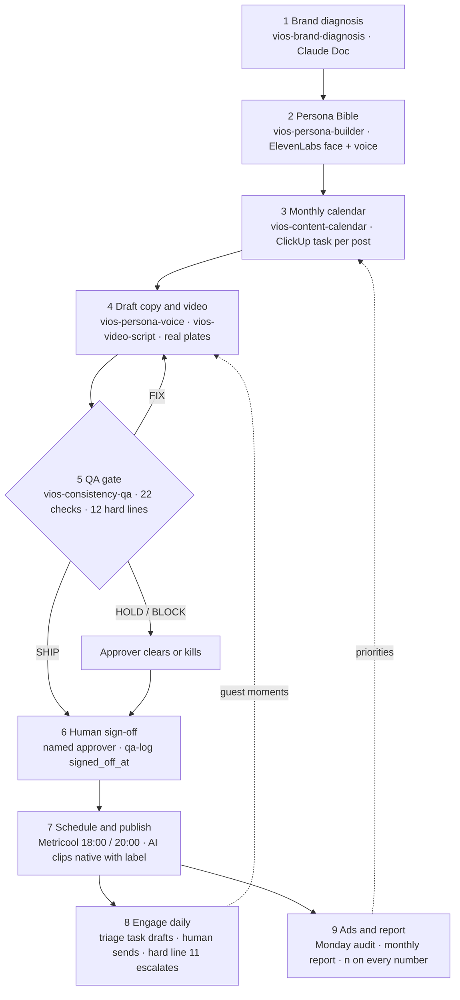

# Workflow — Vios social media management

## Who does what

| Stage | Skill | Tool | Human |
| --- | --- | --- | --- |
| 1 Diagnosis | vios-brand-diagnosis | Claude Doc → `diagnosis.md` | account manager + owner signs |
| 2 Persona | vios-persona-builder | `persona-bible.md`, ElevenLabs flow + voice | account manager; owner informed |
| 3 Calendar | vios-content-calendar | ClickUp list per client, `content/YYYY-MM/calendar.md` | content lead |
| 4 Drafts | vios-persona-voice, vios-video-script | `content/YYYY-MM/*.md`, plates in `character-sheet/plates/` | content lead |
| 5 QA | vios-consistency-qa, vios-be-lens, vios-nonverbal-lens | `qa-log.csv` row | — |
| 6 Sign-off | — | `signed_off_at` filled, ClickUp → Approved | approver |
| 7 Publish | — | Metricool; AI clips posted natively with the platform label | approver clicks |
| 8 Engage | vios-persona-voice | daily triage task → ClickUp Engagement list | approver sends |
| 9 Ads + report | vios-ads-audit, vios-monthly-report | weekly task → Ads list; monthly task → Claude Doc | performance lead; owner for spend |

Rules that hold at every stage: skills draft, humans publish; facts from `fact-sheet.md` only; consents before faces; AI disclosed from frame one.
